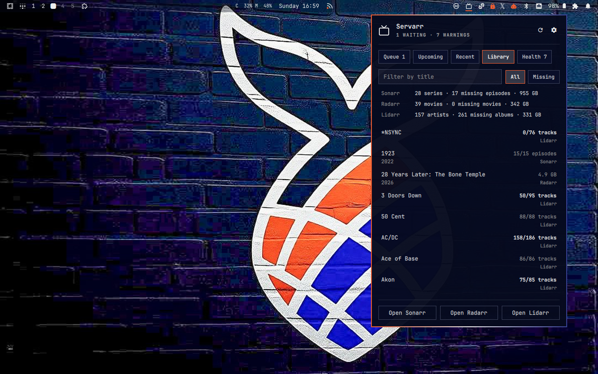

# omaservarr

Omarchy plugin for the Servarr stack: one bar icon and one panel for
[Sonarr](https://sonarr.tv), [Radarr](https://radarr.video) and
[Lidarr](https://lidarr.audio). It shows the download queue, upcoming
releases, recent imports, the library and health warnings, and comes with a
command line tool, a launcher and optional agent skills.

The plugin only reads from your services. Adding a title is done by the
`omaservarr-add` agent skill, if you install the skills, and only after you
confirm it.

## Requirements

- Omarchy **Quattro** (v4.5+) with the plugin runtime
- At least one of Sonarr v3 or newer, Radarr v3 or newer, Lidarr v1 or newer,
  reachable from this machine, and its API key
  (**Settings > General > Security** in each app)
- `curl`; `jq` for the command line tool and for faster library loading

## Install

```sh
omarchy plugin add https://github.com/sette7blo/omaservarr.git --enable
```

That is the only command. The first time the plugin loads, it links the
`omaservarr` command and a launcher. Then click the bar
icon, then the gear. Pick a service, enter its address and API key, click
**Test**, repeat for the others, then **Save**. Leave a service empty to skip
it.

To update: `omarchy plugin update io.github.sette7blo.omaservarr`.

From a clone instead, `./install.sh` does the same and can pre-fill the
addresses:

```sh
./install.sh --sonarr-url http://media:8989 \
             --radarr-url http://media:7878 \
             --lidarr-url http://media:8686
```

`--no-enable` links everything but leaves the bar widget for you to enable.
`--skills` also links the [agent skills](#agent-skills), which are never
installed unless you ask for them.

## What gets installed

| Location | What |
|---|---|
| `~/.config/omarchy/plugins/io.github.sette7blo.omaservarr` | Plugin dir (symlink to this repo) |
| `~/.local/bin/omaservarr` | Command line tool (symlink) |
| `~/.local/share/applications/omaservarr.desktop` | Launcher entry |
| `~/.local/state/omarchy/omaservarr/credentials.json` | Addresses and API keys (mode 600, written by the Settings view) |
| `~/.cache/omarchy/omaservarr/` | One curl header file per service (mode 600) |
| `~/.agents/skills/omaservarr-*`, `~/.claude/skills/omaservarr-*`, etc. | Agent skills, only if you install them and only if the agent dir exists |

## Bar icon

- A TV icon. It is dimmed until a service is connected, takes the accent
  colour while something is downloading and the urgent colour when a service
  is down or reports an error.
- The number of active downloads is shown next to the icon.
- The tooltip gives the totals: downloading, waiting, warnings.
- **Left-click** opens the panel, **middle-click** refreshes,
  **right-click** opens this README.

## Panel

Five tabs over one list. Clicking a row opens that item in the service's
web UI.



| Tab | Shows | Source |
|---|---|---|
| Queue | Active and waiting downloads with progress and time left. Blocked or failed items come first, with the reason. | `GET /queue` |
| Upcoming | Episodes, movies and albums due in the next days, grouped by day | `GET /calendar` |
| Recent | Latest imports. A season pack is one row. | `GET /history` |
| Library | Every series, movie and artist with how much of it is on disk. Filter by title, show only incomplete monitored items, or press a service's totals line on top to show that service alone. | `GET /series`, `/movie`, `/artist`, `/wanted/missing` |
| Health | Each service's own health checks, plus services that are down or reject the key. Rows link to the Servarr wiki. | `GET /health` |

The gear opens settings, the arrow next to it refreshes everything, and the
buttons at the bottom open each service.

### Refresh

- Queue and health: every 60 seconds by default (configurable, 15 seconds
  minimum), and when the panel opens.
- Upcoming, recent and the missing counts: every 15 minutes, and when the
  panel opens.
- Library: only when you open the Library tab, at most every 10 minutes.

## Command line

```sh
omaservarr status                  # which services answer, and their versions
omaservarr queue                   # combined download queue
omaservarr upcoming 14             # due in the next 14 days (default 7)
omaservarr recent                  # latest imports
omaservarr health                  # health checks
omaservarr missing                 # monitored items without files
omaservarr search radarr "dune"    # look a title up (does not add it)
omaservarr open sonarr /calendar   # open a page in the browser
omaservarr api lidarr GET /rootfolder   # raw request below the API root
```

The tool reads `~/.local/state/omarchy/omaservarr/credentials.json`.
`SONARR_URL`, `SONARR_API_KEY` and the `RADARR_`/`LIDARR_` equivalents in the
environment override it for one-off runs. Keys are passed to `curl` on
stdin, not on the command line.

## Agent skills

The skills are optional and are not installed with the plugin. To add them,
open the panel's Settings (the gear) and press **Install agent skills**, or
run:

```sh
~/.config/omarchy/plugins/io.github.sette7blo.omaservarr/install.sh --skills
```

Either links five `SKILL.md` folders into whichever agent homes exist
(`~/.agents/skills/`, `~/.claude/skills/`, `~/.codex/skills/`,
`~/.copilot/skills/`). The plugin itself never creates these links or puts
one back. **Remove agent skills** in Settings, or `uninstall.sh --skills`,
removes them and leaves everything else.

- **omaservarr-queue**: what is downloading, and why something is stuck
- **omaservarr-upcoming**: what airs or releases soon, and recent imports
- **omaservarr-library**: whether a title is in the library, and what is missing
- **omaservarr-health**: whether the services are up, and their warnings
- **omaservarr-add**: add a series, movie or artist, after confirmation

The skills go through the `omaservarr` command, so they use the addresses
and keys you saved in the Settings view and never see a key themselves.

## Privacy and network

The plugin talks only to the addresses you enter, over `http` or `https`,
with a timeout on every request. Text from the services is shown as plain
text and never becomes part of a shell command.

## Tests

```sh
node --test tests/model.test.js
```

## Uninstall

```sh
~/.config/omarchy/plugins/io.github.sette7blo.omaservarr/uninstall.sh
omarchy plugin remove io.github.sette7blo.omaservarr
```

The first removes the links, the saved addresses and keys and the header
cache; the second removes the plugin. Neither touches Sonarr, Radarr or
Lidarr.

## Repository layout

```
manifest.json              Plugin manifest (kinds: service, bar-widget)
Service.qml                Background poller and connection store
BarWidget.qml              The bar icon and download count
Panel.qml                  The panel: tabs, list, library filter
RowItem.qml                One row of the list
SettingsView.qml           Addresses, API keys and refresh settings
Model.js                   Requests, parsing and row building (no QML)
qml/TvIcon.qml             The icon
bin/omaservarr             Command line tool used by the panel and skills
omaservarr.desktop.in      Launcher template (install.sh fills in the CLI path)
agent-skill/               Five SKILL.md files
tests/model.test.js        Node tests for Model.js
install.sh / uninstall.sh  Setup the plugin runs on load, clean uninstall
                           (--skills adds or removes the agent skills)
```

## License

MIT. See `LICENSE`.
